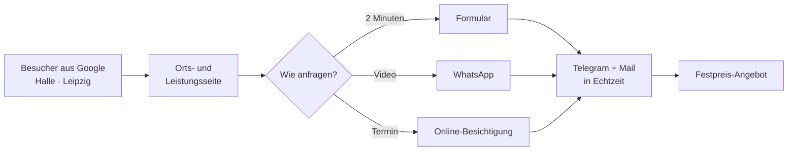
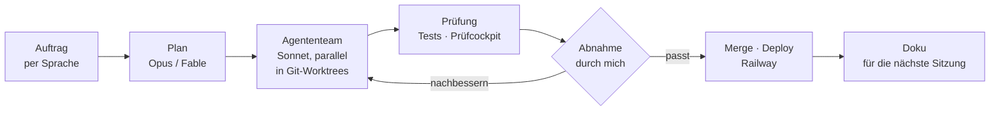
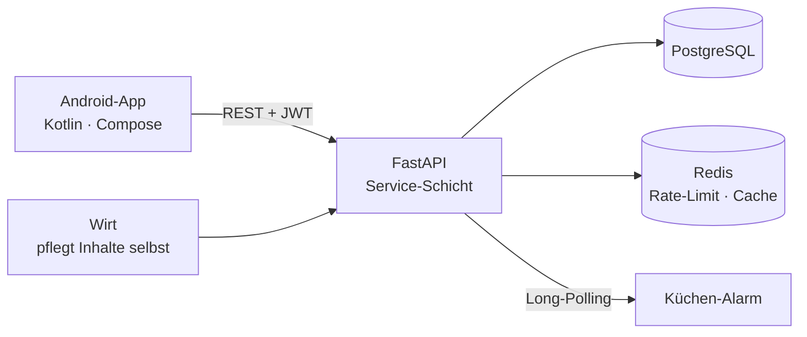
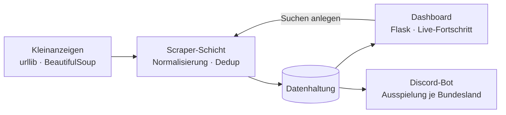
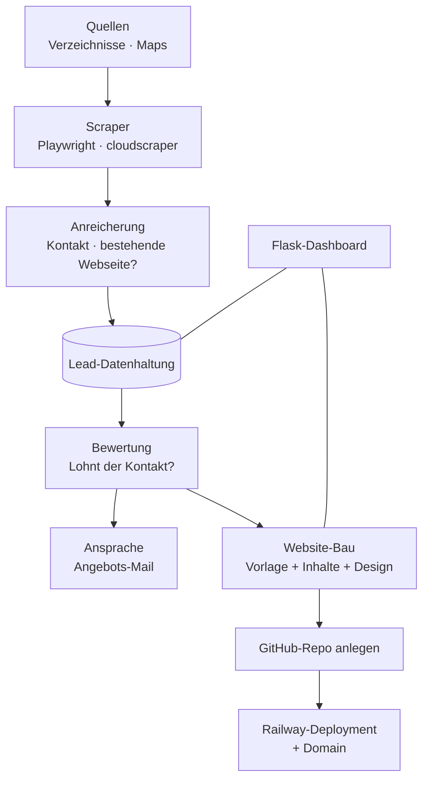
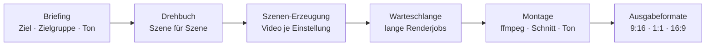
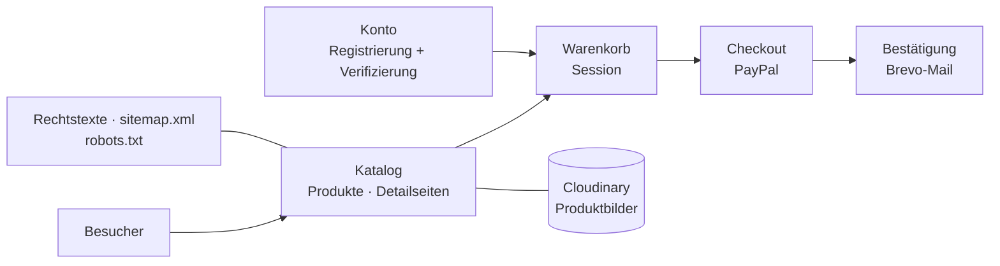
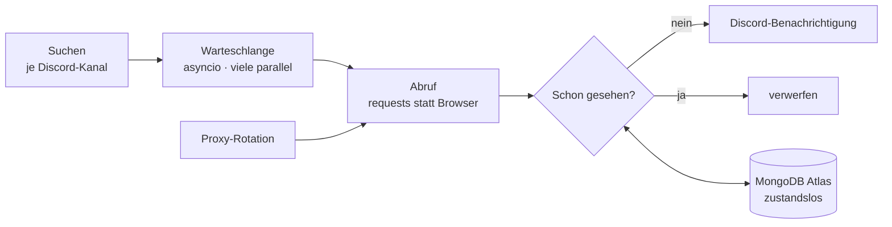

### Hallo, ich bin Bastian.

Ich führe die **[Webagentur Scherzinger](https://webagentur-scherzinger.com)** in Lübeck. Für kleine Betriebe baue ich Webseiten mit Django und kümmere mich danach weiter um sie: Deployment, Domain, Mails, SEO, Inhalte und Änderungen. Daneben entstehen Werkzeuge, die echte Arbeit abnehmen, etwa Bestellsysteme, Scraping-Pipelines und Automatisierung.

Mit 11 habe ich bei Scratch angefangen. Im Juli 2025, direkt nach dem Realschulabschluss, habe ich bewusst wieder bei `hello world` begonnen. Am 1. September 2026 habe ich daraus ein Gewerbe gemacht.

**Aktuell:** Webagentur Scherzinger mit sieben betreuten Live-Seiten · **Ab 2027:** Ausbildung zum Fachinformatiker für Anwendungsentwicklung

 

---

# Webseiten, die ich aktiv betreue

Alle Seiten unten habe ich selbst gebaut und betreue sie bis heute: Konzept, Texte, Django-Umsetzung, Design, Deployment und danach die laufende Pflege. Nach der Übergabe höre ich nicht auf. Ich messe die Suchzahlen, baue nach und reiche neue Seiten bei Google ein.

| Seite | Branche | Live seit | Was ich laufend mache |
|---|---|---|---|
| [Rümpelwerk Mitteldeutschland](https://www.ruempelwerk-mitteldeutschland.de) | Entrümpelung, Halle und Leipzig | Mai 2026 | Pflege, SEO und GEO, neue Leistungs- und Ortsseiten, Backlinks |
| [HG Flügel](https://www.hg-fluegel.de) | Hausmeister und Gebäudeservice, Odenwald | Mai 2026 | monatliche Betreuung, Galerie mit 120 Vorher-nachher-Fotos |
| [RTC-Service](https://www.rtc-service.com) | Klima- und Haustechnik, Waghäusel | Juni 2026 | Bewertungsseite, Preisrechner, Sichtbarkeit |
| [WVM-IT](https://www.wvm-it.tech) | IT-Betreuung, Österreich | Juli 2026 | dreisprachig DE, EN und RO, Google-Unternehmensprofil |
| [1A Entrümpelung](https://www.1a-entruemplung.com) | Entrümpelung, Leipzig | Sep. 2026 | Neubau im September, Preisrechner, Ratgeber |
| [Luviq](https://www.luviq-alsfeld.com) | handbemalte Mode | Apr. 2026 | Archiv, Rechtstexte, Instagram-Anbindung |
| [Autohaus Rhein-Neckar](https://rhein-neckar-production.up.railway.app) | Luxusfahrzeuge | Juni 2026 | Showroom mit drehbaren 3D-Fahrzeugen |

### Referenz: Rümpelwerk Mitteldeutschland

Mein am längsten und am intensivsten betreutes Projekt. Ich habe es im Mai 2026 in einer Nacht gebaut und seitdem jede Woche weiterentwickelt. **Über die Seite kommen laufend echte Aufträge herein.**

- **Anfrage in zwei Minuten:** Formular direkt im Kopfbereich, Festpreis-Angebot per WhatsApp-Video, Besichtigung online buchbar
- **Sofort-Preisrechner** mit Standortlogik und Erinnerungsmail
- **Lokale Sichtbarkeit:** Orts- und Leistungsseiten für Halle, Leipzig und das Umland, strukturierte Daten als `@graph`, `llms.txt` für KI-Suchmaschinen
- **Benachrichtigung in Echtzeit:** Jede Anfrage kommt sofort per Telegram und Mail an
- **Abgesichert:** Spam-Schutz für das Formular, nachdem Bots es im August angegriffen hatten

`990` Commits · `89.058` Zeilen Code · `1.530` Testfunktionen · `32.469` Zeilen Doku

### Weitere Kundenseiten

<table>
<tr>
<td width="50%"></td>
<td width="50%"></td>
</tr>
<tr>
<td><b><a href="https://www.hg-fluegel.de">HG Flügel</a></b> Mein erster Kunde. Hausmeister, Garten und Winterdienst im Odenwald, mit einem <b>Richtangebot in zwei Minuten</b> als zentralem Weg und einer Galerie mit 120 Vorher-nachher-Fotos. <code>928</code> Commits.</td>
<td><b><a href="https://www.1a-entruemplung.com">1A Entrümpelung</a></b> Entrümpelung in Leipzig, im September 2026 komplett neu gebaut. Bewusst weg vom Baukasten-Look: kräftige Typografie, großformatige Bilder und ein <b>Preis in 60 Sekunden</b>.</td>
</tr>
<tr>
<td></td>
<td></td>
</tr>
<tr>
<td><b><a href="https://www.rtc-service.com">RTC-Service</a></b> Klimaanlagen und Haustechnik mit acht Gewerken. Kostenloser <b>Preisrechner direkt im Kopfbereich</b>, Bewertungsseite und direkte Wege über WhatsApp und Telefon. <code>900</code> Commits.</td>
<td><b><a href="https://www.wvm-it.tech">WVM-IT</a></b> IT-Betreuung für Betriebe in Österreich. Dreisprachig DE/EN/RO über ein eigenes i18n-Paket ohne <code>gettext</code>, Rückruf-Formular und Google-Unternehmensprofil.</td>
</tr>
<tr>
<td></td>
<td></td>
</tr>
<tr>
<td><b><a href="https://rhein-neckar-production.up.railway.app">Automobilzentrum Rhein-Neckar</a></b> Mein technisch aufwändigstes Frontend: ein <b>Kinovideo, das der Scroll-Position folgt</b>, und ein Showroom mit <b>Fahrzeugen, die man mit der Maus drehen kann</b>.</td>
<td><b><a href="https://www.luviq-alsfeld.com">Luviq</a></b> Handbemalte Second-Hand-Mode aus Alsfeld als editoriales Archiv. Mein erstes Projekt für eine andere Person.</td>
</tr>
</table>

### Meine Agentur

**[webagentur-scherzinger.com](https://webagentur-scherzinger.com)** ist mein Angebot: programmiert statt Baukasten, online in zwei bis vier Wochen. Mit Fallstudien, Standortseiten, Bewertungen und einem Projektfragebogen. `755` Commits und `1.393` Testfunktionen in sechs Wochen.

> **Was SEO und GEO bei mir konkret heißt:** strukturierte Daten als `@graph` statt loser Schnipsel, `FAQPage`- und `Breadcrumb`-Auszeichnung, `llms.txt` und eine für KI-Crawler geöffnete `robots.txt`, Antwort-zuerst-Texte, Local SEO mit Orts- und Leistungsseiten und danach die Messung in der Search Console.

### So arbeite ich mit KI-Agenten

Ich arbeite mit Claude Code und lasse ganze Agententeams für mich arbeiten. Die Entscheidungen und die Abnahme bleiben bei mir. Allein zwischen dem 10. September und dem 15. Oktober 2026 waren das 984 gestartete Agenten und über 160.000 Werkzeugaufrufe. 58 % meiner Commits seit Mai tragen Claude als Co-Autor.

Damit nichts nach KI aussieht, prüfe ich jede Seite gegen eigene Design-Regeln. Damit nichts verloren geht, wird alles dokumentiert: Ein Drittel meiner Commits sind Doku-Commits.

 

---

# Reichweite

Auf TikTok veröffentliche ich als **[@python_tutorials_de](https://www.tiktok.com/@python_tutorials_de)** Python-Tutorials und zeige, woran ich gerade baue. Angefangen bei null.

Das war nie nur Nebensache. Erklären zwingt zum Verstehen — und der Kanal ist bis heute mein wichtigster Vertriebsweg: **mehrere meiner zahlenden Kunden haben mich über TikTok gefunden**, angefangen beim allerersten Auftrag, der aus einem Kommentar unter einem Video entstand.

Am besten liefen zwei Videos über meine **Scraping-Dashboards** mit **126.000** und **100.000** Aufrufen — gezeigte Projekte ziehen deutlich mehr als reine Tutorials.

 

---

# Der Weg hierher

**→ [Als scroll-gesteuerte Seite ansehen](https://bastianscherzinger.github.io/BastianScherzinger/zeitleiste/)** — dort wächst die Zeitleiste mit, während man scrollt.

Zwei Dinge in dieser Zeitleiste haben mehr verändert als alles andere.

Das erste war die **Programmier-AG im Internat**. Zehn bis fünfzehn Mitschülern Python beizubringen zwang mich, Konzepte so weit zu durchdringen, dass ich sie erklären konnte. Wer eine `for`-Schleife dreimal unterschiedlich erklären muss, bis es klick macht, versteht sie danach selbst anders.

Das zweite war ein **Kommentar unter einem TikTok-Video**. Jemand fragte, ob ich einen Vinted-Scraper mit Discord-Anbindung bauen könne. Ich sagte zu, lieferte — und aus „Python lernen" wurde „Software für fremde Anforderungen bauen". Alles danach folgte aus diesem einen Auftrag.

 

# Fähigkeiten

> Die Einstufungen sind aus gemessener Nutzung abgeleitet, nicht geschätzt: Codezeilen, Testfunktionen und produktive Projekte. Wo ich schwach bin, steht das genauso da wie das, was ich kann.

 

---

# Weitere Projekte

Neben den Webseiten entstehen Werkzeuge, die konkrete Arbeit abnehmen.

## LieferungDirekt — Bestellsystem für ein Restaurant

FastAPI-Backend mit PostgreSQL und Redis, dazu eine native Android-App in Kotlin und Jetpack Compose. Bestellungen lösen im Laden einen Alarm aus — ohne Firebase, über einen eigenen Long-Polling-Kanal. Für Betreiberkonten ist Zwei-Faktor-Authentifizierung per TOTP Pflicht.

Der Teil, auf den ich am meisten Wert gelegt habe, steht nicht im Code: Der Wirt pflegt Speisekarte, Fotos, Stammdaten und Rechtstexte selbst in der App. Das System gehört nach der Übergabe ihm, nicht mir.

`17.744` Zeilen Python · `13.174` Zeilen Kotlin · `214` Tests · Docker · 10 Doku-Dateien
Übergabefertig: Der Wirt bekommt fertige APK, Server und Übergabetext.

---

## livingen — Wohnungs-Pipeline mit Discord-Ausspielung

Scrapt Mietwohnungsangebote, sortiert sie nach Bundesland und spielt sie über einen Discord-Bot aus. Technisch mein saubersten gebautes Projekt: das einzige mit durchgehender Testabdeckung, Docker und GitHub Actions.

`47.785` Zeilen Python · `1.545` Testfunktionen in `137` Dateien · Docker · CI

**→ [Zur Seite](https://livingen-web-production.up.railway.app)**

---

## JARVIS — Lead-Pipeline und Website-Generator

Deckt den Weg von der Lead-Recherche bis zur fertig deployten Kundenwebseite ab. Entstanden aus einem praktischen Problem: Der zeitaufwändigste Teil meiner Arbeit war nie das Programmieren, sondern Betriebe finden, Kontakte recherchieren, Inhalte zusammentragen, aufsetzen, deployen.

Ehrlich eingeordnet: Die Idee trägt weiter als die Umsetzung. Bei `44.285` Zeilen stehen nur `258` Testfunktionen in vier Dateien, es gibt kein Docker-Setup und keine CI. Genau das ist die Baustelle, an der ich gerade arbeite.

`44.285` Zeilen Python · `189` Module · `258` Commits

**→ [Repository](https://github.com/BastianScherzinger/jarvis2)**

---

## MEDIAPIPE WVM — KI-Video-Studio

Auftragsarbeit: aus einem Briefing entsteht ein Drehbuch, daraus werden Videoszenen erzeugt und anschließend in alle benötigten Ausgabeformate geschnitten. Ein Durchlauf, der vorher aus vielen Einzelwerkzeugen bestand.

`8.147` Zeilen Python · `181` Tests · Flask · ffmpeg · ausführlichste Dokumentation aller meiner Projekte

**→ [Repository](https://github.com/BastianScherzinger/mediapipe-wvm)**

---

## Luviq Universe — Onlineshop

Der Django-Shop hinter [luviq-alsfeld.com](https://www.luviq-alsfeld.com). Die Views habe ich nachträglich von einer einzelnen Datei in ein Package nach Zuständigkeiten aufgeteilt — ab etwa tausend Zeilen war jede Änderung eine Sucherei geworden. Das ist die Lektion, die ich aus diesem Projekt mitgenommen habe.

`Django 5` · `PostgreSQL` · `PayPal` · `Cloudinary` · `Brevo` · `django-axes` · Docker

**→ [Zur Seite](https://www.luviq-alsfeld.com)** · **[Repository](https://github.com/BastianScherzinger/Webseitemitstripe)**

---

## VintedBot — mein erster bezahlter Auftrag

Ein Discord-Bot, der Vinted-Suchen überwacht und Treffer meldet. Die erste Fassung steuerte einen echten Browser und brauchte rund 1,5 GB Arbeitsspeicher — zu viel für das Hosting-Paket. Ich habe den Browser entfernt und das HTML direkt geparst: Speicherbedarf unter 200 MB.

Das war mein erstes echtes Architektur-Problem. Nicht „funktioniert es?", sondern „funktioniert es unter den Bedingungen, die tatsächlich gelten?".

`Python` · `asyncio` · `discord.py` · `MongoDB` · `Docker`

**→ [Repository](https://github.com/BastianScherzinger/VintedBot)**

 

---

# Was schon vor der Ausbildung steht

Meine Ausbildung zum Fachinformatiker für Anwendungsentwicklung beginnt 2027. Einige Lernfelder decken sich bereits mit dem, was ich gebaut habe:

| Bereich | Belegt durch |
|---|---|
| Software modellieren und programmieren | 15 Projekte, `170.668` Zeilen Python |
| Datenbanken anlegen und nutzen | PostgreSQL, SQLite, Supabase inklusive Row-Level-Security |
| Anwendungen mit Schnittstellen | Eigenes FastAPI-Backend, Anbindung mehrerer externer APIs |
| Qualitätssicherung und Testen | `2.324` Testfunktionen — schwerpunktmäßig in zwei Projekten |
| Sicherheit | TOTP-Zweifaktor, JWT mit Rotation, Rate-Limiting, RLS |
| Benutzeroberflächen | Native Android-App, sieben produktive Weboberflächen |
| Kundenkommunikation | Eigenes Gewerbe, Verträge, Übergaben und laufende Betreuung von sieben Live-Seiten |
| Netzwerke und Betriebssysteme | Linux, Raspberry-Pi-Cluster, Deployment und Domainverwaltung |

Was noch fehlt: strukturierte CI/CD über alle Projekte hinweg, Datenbank-Optimierung und Arbeit im Team mit Branches und Code-Reviews. Daran arbeite ich gezielt.

 

# Woran ich gerade arbeite

- **Sichtbarkeit meiner Kundenseiten**: Suchzahlen messen, Orts- und Leistungsseiten ausbauen, Backlinks
- **Werbevideos** für Betriebe als neue Leistung
- **Testabdeckung und CI** auf die älteren Projekte ausweiten — der größte Abstand zu sauberer Arbeit
- **`ruff` und Type-Hints** als Standard in jedem neuen Projekt
- Die **Webagentur Scherzinger** weiter aufbauen, neben der Ausbildung ab 2027

 

# Kontakt

Alle Kennzahlen auf dieser Seite sind gemessen: Codezeilen über <code>find</code> und <code>wc</code> ohne Fremdbibliotheken, Testfunktionen über <code>def test_</code>, Commits aus der Git-Historie, Seiten per HTTP-Abruf geprüft. Die Reichweiten-Zahlen stammen aus der TikTok-Statistik des Kanals, Stand August 2026. Commits, Repos, Tests und Agenten-Zahlen: gemessen am 15.10.2026 über 38 eigene Repos ohne Kopien und Arbeitsbäume.
